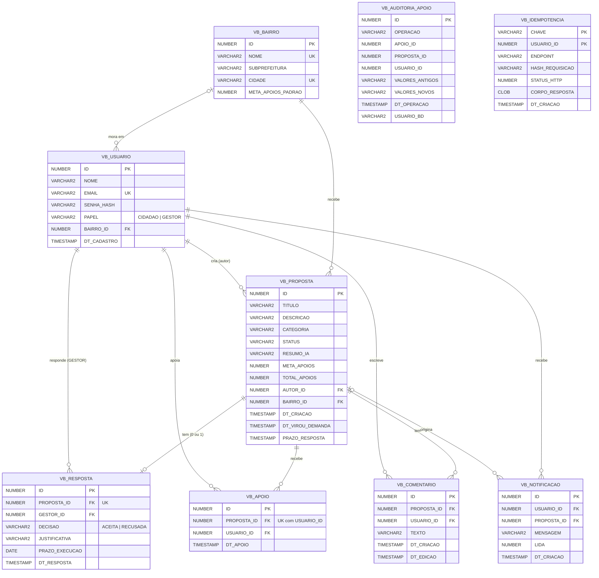

# Voz do Bairro — Banco de Dados (Oracle + MongoDB)

**Global Solution FIAP 2026/2 — tema CitizenTech**
**Disciplina:** Mastering Relational and Non-Relational Database
**Desafio:** *Do Oracle ao MongoDB — dados a serviço do cidadão*

**Integrantes**

| Nome | RM | Turma |
|------|----|-------|
| Andrei de Paiva Gibbini | 563061 | 2TDSPF |
| Arthur Câmara | 562310 | 2TDSPG |
| Diogo Cunha | 563654 | 2TDSPF |
| Pedro Sakai Silva Zambaca | 565956 | 2TDSPF |
| Pedro Santos Pequini | 561842 | 2TDSPF |

Responsável por esta disciplina: **Arthur Câmara (RM 562310)**.


---

## 1. O problema

Em São Paulo, o morador que vê um problema no bairro (rua escura, buraco, falta de pediatra na UBS) não tem um canal **público** para mostrar que aquilo é uma demanda coletiva, nem como saber se a prefeitura respondeu. O **Voz do Bairro** resolve isso:

1. o morador cria uma **proposta** de melhoria para o seu bairro;
2. os vizinhos **apoiam**; ao atingir a **meta de apoios** a proposta vira **DEMANDA**;
3. a prefeitura tem **15 dias** para responder (ACEITA → EM_EXECUÇÃO, ou RECUSADA com justificativa); sem resposta no prazo ela fica **ATRASADA**;
4. tudo é público em um **placar por bairro** (quantas demandas, quantas atrasadas, taxa de resposta no prazo).

ODS relacionados: **11** (cidades sustentáveis), **10** (redução das desigualdades — bairros periféricos têm o mesmo peso) e **16** (instituições eficazes e transparentes).

Este projeto é a camada de dados: o **Oracle** é a fonte da verdade (compartilhada com as APIs Java e .NET do grupo) e guarda as regras de negócio em PL/SQL; o **MongoDB** recebe uma representação documental dos mesmos dados, pensada para leitura pública (placar e página da proposta).

---

## 2. Estrutura de arquivos

```
voz-do-bairro-banco/
├── README.md                          (este documento)
├── NOTAS-REVISAO.md                   (o que conferir ao rodar)
└── scripts/
    ├── oracle/
    │   ├── 00_executar_tudo.sql       chama 01..08 na ordem (@@)
    │   ├── 01_ddl.sql                 DDL do contrato (fiel) + índices
    │   ├── 02_dados.sql               dados de teste (6 bairros, 15 usuários, 18 propostas...)
    │   ├── 03_pkg_proposta.sql        pacote PKG_PROPOSTA (spec + body)
    │   ├── 04_pkg_transparencia.sql   pacote PKG_TRANSPARENCIA (spec + body)
    │   ├── 05_triggers.sql            TRG_VB_APOIO_AUDITORIA, TRG_VB_PROPOSTA_STATUS
    │   ├── 06_blocos_anonimos.sql     3 blocos anônimos (cursor/loop/IF)
    │   ├── 07_testes.sql              57 casos de teste (esperado x obtido), com ROLLBACK
    │   └── 08_relatorios_equivalentes.sql  SQL equivalente às consultas Mongo (R1..R6)
    └── mongodb/
        ├── 01_carga.js                database, 2 collections com $jsonSchema, 24 documentos
        └── 02_consultas.js            consultas R1..R6 (find, find+projeção, 3 aggregates)
```

---

## 3. Modelo relacional (Oracle 19c)

O DDL é o **contrato comum** do grupo (`contrato/script-bd-base.sql`) e foi copiado sem alterações de tabela/coluna; este projeto **acrescenta** índices, pacotes, gatilhos e dados.



**Ciclo de vida da proposta** (contrato, seção 2 — validado pelo gatilho `TRG_VB_PROPOSTA_STATUS`):

| De → Para | Quem faz | Regra |
|---|---|---|
| (novo) → ABERTA | API Java | META_APOIOS = meta padrão do bairro |
| ABERTA → DEMANDA | API .NET / `PRC_CONVERTER_EM_DEMANDA` | TOTAL_APOIOS ≥ META_APOIOS; prazo = agora + 15 dias |
| DEMANDA → ATRASADA | API Java (agendador) / `PRC_MARCAR_ATRASADAS` | prazo vencido sem VB_RESPOSTA |
| DEMANDA/ATRASADA → EM_EXECUCAO | API Java / `PRC_REGISTRAR_RESPOSTA` | gestor ACEITA com prazo de execução |
| DEMANDA/ATRASADA → RECUSADA | API Java / `PRC_REGISTRAR_RESPOSTA` | gestor RECUSA com justificativa |
| EM_EXECUCAO → CONCLUIDA | API Java | gestor conclui |

**Índices acrescentados** (01_ddl.sql): `IX_VB_PROPOSTA_BAIRRO_STATUS (BAIRRO_ID, STATUS)` (placar), `IX_VB_PROPOSTA_STATUS_PRAZO (STATUS, PRAZO_RESPOSTA)` (agendador de atrasos), `IX_VB_PROPOSTA_AUTOR`, `IX_VB_APOIO_USUARIO` (a UK de VB_APOIO começa por PROPOSTA_ID e não atende "propostas que eu apoiei"), `IX_VB_COMENTARIO_PROPOSTA`, `IX_VB_NOTIFICACAO_USUARIO (USUARIO_ID, LIDA)` e `IX_VB_AUDITORIA_APOIO_PROP`.

---

## 4. Dados de teste (02_dados.sql)

Bairros reais de São Paulo; os **3 bairros, 3 usuários e 2 propostas do seed do contrato mantêm IDs, ordem, textos e hash de senha** (senha de todos: `Senha@123`). As chaves estrangeiras são resolvidas por subselect (`WHERE EMAIL = ...`, `WHERE NOME = ...`, `WHERE TITULO = ...`), sem IDs "mágicos". As datas são **relativas a `SYSTIMESTAMP`** (ex.: criada há 25 dias, virou demanda há 3 dias), então os status continuam coerentes em qualquer dia em que o script for executado.

| Tabela | Linhas |
|---|---|
| VB_BAIRRO | 6 (Vila Mariana, Capão Redondo, Itaquera, Brasilândia, Grajaú, Mooca) |
| VB_USUARIO | 15 (12 CIDADAO, 3 GESTOR) |
| VB_PROPOSTA | 18 (7 ABERTA, 3 DEMANDA, 2 ATRASADA, 2 EM_EXECUCAO, 2 RECUSADA, 2 CONCLUIDA) |
| VB_RESPOSTA | 6 |
| VB_APOIO | 133 (= soma de TOTAL_APOIOS) |
| VB_COMENTARIO | 15 |
| VB_NOTIFICACAO | 68 |

| ID | Proposta | Bairro | Categoria | Status | Apoios/Meta | Coerência |
|---|---|---|---|---|---|---|
| 1 | Iluminação na Rua Agnaldo Macedo *(seed)* | Capão Redondo | SEGURANCA | ABERTA | 7/30 | sem datas de demanda |
| 2 | Faixa de pedestre em frente à EMEF *(seed)* | Capão Redondo | MOBILIDADE | ABERTA | 5/30 | idem |
| 3 | Reforma da quadra do CEU Capão Redondo | Capão Redondo | LAZER | DEMANDA | 9/8 | virou há 3,4 d; prazo daqui a 11,6 d |
| 4 | UBS do Capão Redondo aberta aos sábados | Capão Redondo | SAUDE | ATRASADA | 10/10 | prazo venceu há 10,5 d; sem resposta |
| 5 | Limpeza do córrego Pirajuçara-Mirim | Capão Redondo | MEIO_AMBIENTE | EM_EXECUCAO | 8/8 | ACEITA **no prazo** |
| 6 | Poda de árvores na Rua Domingos de Morais | Vila Mariana | ZELADORIA | ABERTA | 4/50 | |
| 7 | Ciclofaixa na Rua Sena Madureira | Vila Mariana | MOBILIDADE | RECUSADA | 11/10 | RECUSADA **no prazo** |
| 8 | Rondas e iluminação na saída do metrô Santa Cruz | Vila Mariana | SEGURANCA | DEMANDA | 10/10 | prazo daqui a 12,8 d |
| 9 | Cobertura nos pontos de ônibus da Av. Jacu-Pêssego | Itaquera | MOBILIDADE | ATRASADA | 11/10 | prazo venceu há 5,3 d |
| 10 | Reabertura da biblioteca comunitária de Itaquera | Itaquera | EDUCACAO | CONCLUIDA | 9/8 | ACEITA **no prazo** |
| 11 | Tapa-buracos na Rua Victório Santim | Itaquera | ZELADORIA | ABERTA | 6/40 | |
| 12 | Pediatra todos os dias na UBS Vila Brasilândia | Brasilândia | SAUDE | EM_EXECUCAO | 10/10 | ficou ATRASADA e foi ACEITA **fora do prazo** |
| 13 | Coleta seletiva semanal na Brasilândia | Brasilândia | MEIO_AMBIENTE | ABERTA | 3/10 | |
| 14 | Iluminação da escadaria da Rua Parapuã | Brasilândia | SEGURANCA | DEMANDA | 10/10 | prazo daqui a 13,7 d |
| 15 | Linha de ônibus noturna Grajaú - Terminal Santo Amaro | Grajaú | MOBILIDADE | RECUSADA | 8/8 | ATRASADA e RECUSADA **fora do prazo** |
| 16 | Revitalização da Praça do Jardim Shangri-lá | Grajaú | LAZER | CONCLUIDA | 8/8 | ACEITA **no prazo** |
| 17 | Horta comunitária na Praça Kennedy | Mooca | MEIO_AMBIENTE | ABERTA | 2/10 | |
| 18 | Academia ao ar livre no Parque Santo Dias | Capão Redondo | LAZER | ABERTA | 2/30 | |

Regras de coerência garantidas (e conferidas no fim do 02_dados.sql e no bloco 3 do 06):
- `TOTAL_APOIOS` = número de linhas em `VB_APOIO` de cada proposta; ninguém apoia a própria proposta; só CIDADAO apoia; nenhum apoio é posterior à resposta da prefeitura.
- ABERTA tem `TOTAL_APOIOS < META_APOIOS`; demais status têm meta atingida, `DT_VIROU_DEMANDA` e `PRAZO_RESPOSTA = DT_VIROU_DEMANDA + 15 dias`.
- DEMANDA: prazo no futuro. ATRASADA: prazo vencido e sem resposta. EM_EXECUCAO/CONCLUIDA: resposta ACEITA com prazo de execução. RECUSADA: resposta RECUSADA.
- Propostas que já atingiram a meta em bairros de meta padrão alta (Vila Mariana 50, Capão 30, Itaquera 40) usam **meta reduzida (piloto)** de 8 a 10 apoios, para que a base de teste tenha apoios reais coerentes. Os bairros novos já têm meta padrão baixa (8 a 10).
- Os usuários 1 e 2 do contrato **não** apoiam as propostas 1 e 2, para não quebrar o roteiro de teste das APIs ("vizinho apoia a proposta 1").

---

## 5. Regras de negócio em PL/SQL

Nenhuma procedure faz `COMMIT`: quem chama controla a transação (API, script ou teste com `SAVEPOINT/ROLLBACK`).

### 5.1 Pacote `PKG_PROPOSTA` (03_pkg_proposta.sql)

| Objeto | Tipo | Regra de negócio |
|---|---|---|
| `FN_CALCULAR_PRIORIDADE(p_proposta_id)` | função → NUMBER | Score para a prefeitura decidir o que atender primeiro (fórmula abaixo). |
| `FN_APOIOS_FALTANTES(p_proposta_id)` | função → NUMBER | Quantos apoios faltam para a meta (0 se já atingiu) — usado na tela da proposta. |
| `PRC_CONVERTER_EM_DEMANDA(p_proposta_id)` | procedure | Bloqueia a linha (`FOR UPDATE`), valida status ABERTA e meta atingida, muda para DEMANDA com `DT_VIROU_DEMANDA = agora` e `PRAZO_RESPOSTA = agora + 15 dias`, notifica o autor e **todos** os gestores. |
| `PRC_MARCAR_ATRASADAS(p_qtd OUT)` / `PRC_MARCAR_ATRASADAS` | procedure (sobrecarga) | Cursor `FOR UPDATE` sobre DEMANDAS com prazo vencido e sem VB_RESPOSTA → ATRASADA (`WHERE CURRENT OF`), notifica autor e gestores, devolve/mostra a quantidade. Idempotente (2ª execução marca 0). |

**Fórmula da prioridade** (0 a 170):

```
score = ( 60 × MIN(TOTAL_APOIOS / META_APOIOS, 1)     ← engajamento da comunidade (até 60)
        + 40 × MIN(DIAS_EM_ABERTO / 60, 1) )          ← tempo de espera, satura em 60 dias (até 40)
        × PESO_CATEGORIA                               ← 1,5 para SEGURANCA e SAUDE; 1,0 demais
        + 20 se STATUS = ATRASADA                      ← prefeitura já está devendo resposta
DIAS_EM_ABERTO = dias inteiros desde DT_CRIACAO
EM_EXECUCAO, CONCLUIDA e RECUSADA → 0 (já tratadas)
```

Exemplo: UBS do Capão (SAUDE, 10/10, 45 dias, ATRASADA) → (60×1 + 40×0,75) × 1,5 + 20 = **155**.

Erros: `-20001` proposta não encontrada · `-20002` status não é ABERTA · `-20003` meta não atingida.

### 5.2 Pacote `PKG_TRANSPARENCIA` (04_pkg_transparencia.sql)

| Objeto | Tipo | Regra de negócio |
|---|---|---|
| `FN_TAXA_RESPOSTA_NO_PRAZO(p_bairro_id)` | função → NUMBER | % de demandas respondidas dentro do prazo. **Avaliáveis** = viraram DEMANDA e já têm resposta **ou** o prazo já venceu (demanda dentro do prazo ainda não conta). **No prazo** = `DT_RESPOSTA <= PRAZO_RESPOSTA`. `NULL` quando não há avaliáveis; `p_bairro_id NULL` = cidade toda. |
| `FN_CLASSIFICAR_TAXA(p_taxa)` | função → VARCHAR2 | ≥ 80 BOM · ≥ 50 REGULAR · < 50 CRÍTICO · NULL SEM DADOS. |
| `PRC_REGISTRAR_RESPOSTA(p_proposta_id, p_gestor_id, p_decisao, p_justificativa, p_prazo_execucao)` | procedure | Valida usuário GESTOR, decisão ACEITA/RECUSADA (aceita minúsculas), justificativa obrigatória, ACEITA exige prazo de execução futuro, proposta em DEMANDA/ATRASADA e ainda sem resposta; grava VB_RESPOSTA, muda o status (EM_EXECUCAO ou RECUSADA) e notifica o autor. |
| `PRC_RELATORIO_BAIRRO(p_bairro_id)` | procedure | Placar via `DBMS_OUTPUT`: propostas e apoios por status (todos os status, mesmo zerados), taxa no prazo com classificação e top 3 pendentes por prioridade. |

Erros: `-20010` bairro não encontrado · `-20011` gestor não encontrado · `-20012` usuário não é GESTOR · `-20013` decisão inválida · `-20014` justificativa vazia · `-20015` proposta não encontrada · `-20016` status não aceita resposta · `-20017` ACEITA sem prazo futuro · `-20018` proposta já respondida.

### 5.3 Gatilhos (05_triggers.sql)

| Gatilho | Evento | O que faz |
|---|---|---|
| `TRG_VB_APOIO_AUDITORIA` | `AFTER INSERT OR UPDATE OR DELETE ON VB_APOIO FOR EACH ROW` | **Trilha de auditoria**: grava em VB_AUDITORIA_APOIO a operação, ids, `VALORES_ANTIGOS`/`VALORES_NOVOS` como texto JSON (`{"id":..,"propostaId":..,"usuarioId":..,"dtApoio":".."}`), `DT_OPERACAO` e `USUARIO_BD` (usuário da sessão). INSERT só tem novos; DELETE só antigos; UPDATE os dois. Prova que um apoio removido existiu (transparência). |
| `TRG_VB_PROPOSTA_STATUS` | `BEFORE UPDATE OF STATUS ON VB_PROPOSTA FOR EACH ROW` | **Máquina de estados**: só aceita as transições da tabela da seção 3 (e regravar o mesmo status, comum em ORMs); qualquer outra → `-20020`. Ao virar DEMANDA, preenche `DT_VIROU_DEMANDA` e `PRAZO_RESPOSTA` (+15 dias) **apenas se vierem nulos** — a API .NET já envia as datas e elas são preservadas. |

Os gatilhos não consultam a tabela que os disparou (sem *mutating table*, ORA-04091) e não mexem em `TOTAL_APOIOS` (o contador é responsabilidade da API .NET, conforme o contrato).

### 5.4 Blocos anônimos (06_blocos_anonimos.sql)

| Bloco | Técnicas | Resultado esperado com os dados da carga |
|---|---|---|
| 1 — Ranking de prioridade | cursor `FOR`, `IF/ELSIF` (faixas ALTA ≥ 100, MÉDIA ≥ 30, BAIXA), alerta para SEGURANCA/SAUDE atrasada | 12 pendentes: 4 ALTA, 2 MÉDIA, 6 BAIXA; alerta na #4 (ver tabela abaixo) |
| 2 — Transparência por bairro | cursor `FOR` com subconsultas, chamada de função, `IF/ELSIF`, contadores | BOM 1 · REGULAR 3 · CRÍTICO 1 · SEM DADOS 1; cidade 50% |
| 3 — Integridade de apoios | cursor explícito `OPEN/FETCH/EXIT WHEN %NOTFOUND/CLOSE`, `%ROWTYPE` | "OK: 18 propostas verificadas, nenhuma divergência." |

Ranking esperado no dia da carga (os dias em aberto crescem com o tempo, então valores de propostas com menos de 60 dias sobem levemente nos dias seguintes):

| Pos. | ID | Proposta | Status | Categoria | Apoios | Dias | Prioridade |
|---|---|---|---|---|---|---|---|
| 1 | 4 | UBS do Capão Redondo aberta aos sábados | ATRASADA | SAUDE | 10/10 | 45 | 155,00 |
| 2 | 9 | Cobertura nos pontos de ônibus da Av. Jacu-Pêssego | ATRASADA | MOBILIDADE | 11/10 | 50 | 113,33 |
| 3 | 8 | Rondas e iluminação na saída do metrô Santa Cruz | DEMANDA | SEGURANCA | 10/10 | 20 | 110,00 |
| 4 | 14 | Iluminação da escadaria da Rua Parapuã | DEMANDA | SEGURANCA | 10/10 | 15 | 105,00 |
| 5 | 3 | Reforma da quadra do CEU Capão Redondo | DEMANDA | LAZER | 9/8 | 25 | 76,67 |
| 6 | 1 | Iluminação na Rua Agnaldo Macedo | ABERTA | SEGURANCA | 7/30 | 12 | 33,00 |
| 7 | 13 | Coleta seletiva semanal na Brasilândia | ABERTA | MEIO_AMBIENTE | 3/10 | 5 | 21,33 |
| 8 | 2 | Faixa de pedestre em frente à EMEF | ABERTA | MOBILIDADE | 5/30 | 10 | 16,67 |
| 9 | 17 | Horta comunitária na Praça Kennedy | ABERTA | MEIO_AMBIENTE | 2/10 | 4 | 14,67 |
| 10 | 11 | Tapa-buracos na Rua Victório Santim | ABERTA | ZELADORIA | 6/40 | 6 | 13,00 |
| 11 | 6 | Poda de árvores na Rua Domingos de Morais | ABERTA | ZELADORIA | 4/50 | 8 | 10,13 |
| 12 | 18 | Academia ao ar livre no Parque Santo Dias | ABERTA | LAZER | 2/30 | 3 | 6,00 |

### 5.5 Testes (07_testes.sql)

57 casos, todos com `[OK]`/`[FALHOU]`, esperado x obtido e, nos casos de erro, comparação do `SQLCODE`. Cada grupo roda dentro de `SAVEPOINT` e termina com `ROLLBACK TO` (os dados da carga não mudam).

| Grupo | Casos | Destaques |
|---|---|---|
| Teste 1 — PKG_PROPOSTA | 15 | prioridade 50 (ZELADORIA) x 75 (SAUDE, peso 1,5); CONCLUIDA = 0; erros -20001/-20002/-20003; conversão gera DEMANDA com prazo de 15 dias e 1 + 3 notificações; varredura de atrasadas marca 1 e na 2ª execução 0 |
| Teste 2 — PKG_TRANSPARENCIA | 27 | taxas por bairro (100/50/50/0/50/NULL; cidade 50); classificação; erros -20010 a -20018; ACEITA leva DEMANDA → EM_EXECUCAO e a taxa da Brasilândia vai de 0 para 50; RECUSADA de demanda ATRASADA |
| Teste 3 — TRG_VB_PROPOSTA_STATUS | 11 | 4 transições inválidas → -20020; mesmo status permitido; trigger preenche datas; datas enviadas (como a API .NET) preservadas; fluxo do Java aceito |
| Teste 4 — TRG_VB_APOIO_AUDITORIA | 4 | INSERT/UPDATE/DELETE de um apoio geram 3 linhas na auditoria com valores antigos/novos corretos e usuário do banco; consulta da auditoria aparece como grade (evidência) |

---

## 6. Do Oracle ao MongoDB — transição

### 6.1 Collections

Database **`vozdobairro`**, com 2 collections criadas com validação `$jsonSchema` (`validationLevel: strict`, `validationAction: error`):

- **`bairros`** (6 documentos) — dados do bairro + `estatisticas` embutidas (total de propostas, contagem por status, total de apoios, taxa de resposta no prazo) calculadas no momento da carga.
- **`propostas`** (18 documentos) — a proposta com tudo o que a página pública mostra em **uma leitura**: autor resumido, bairro, apoios, comentários, resposta da prefeitura e histórico de status.

Total: **24 documentos** (mínimo exigido: 10). Cada documento — e cada apoio, comentário e resposta embutidos — guarda o **`oracleId`** da linha correspondente no Oracle.

Exemplo (proposta 12, resumido; no script as datas são `diasAtras(n)`, que gravam `ISODate`):

```js
{
  oracleId: 12,                                   // VB_PROPOSTA.ID
  titulo: "Pediatra todos os dias na UBS Vila Brasilândia",
  categoria: "SAUDE", status: "EM_EXECUCAO",
  metaApoios: 10, totalApoios: 10,
  autor:  { id: 9, nome: "Lucas Gabriel Souza" }, // VB_USUARIO (resumo)
  bairro: { bairroId: 4, nome: "Brasilândia" },   // referência -> bairros.oracleId
  dtCriacao: ISODate(...), dtVirouDemanda: ISODate(...), prazoResposta: ISODate(...),
  resposta: { oracleId: 4, gestor: { id: 3, nome: "Carla Gestora" }, decisao: "ACEITA",
              justificativa: "...", prazoExecucao: ISODate(...), dtResposta: ISODate(...) },
  apoios: [ { oracleId: 91, usuarioId: 10, dtApoio: ISODate(...) }, /* ... 10 itens */ ],
  comentarios: [ { oracleId: 11, usuario: { id: 10, nome: "Patrícia Nogueira" },
                   texto: "Respondeu fora do prazo, mas pelo menos aceitaram.", dtCriacao: ISODate(...) } ],
  historicoStatus: [
    { status: "ABERTA",      em: ISODate(...), origem: "VB_PROPOSTA.DT_CRIACAO" },
    { status: "DEMANDA",     em: ISODate(...), origem: "VB_PROPOSTA.DT_VIROU_DEMANDA" },
    { status: "ATRASADA",    em: ISODate(...), origem: "VB_NOTIFICACAO.DT_CRIACAO (aviso de atraso)" },
    { status: "EM_EXECUCAO", em: ISODate(...), origem: "VB_RESPOSTA.DT_RESPOSTA" }
  ]
}
```

### 6.2 Mapa relacional → documental

| Oracle (tabela.coluna) | MongoDB (collection.campo) | Estratégia | Por quê |
|---|---|---|---|
| VB_BAIRRO (linha) | `bairros` (documento) | collection própria | Entidade independente, com ciclo de vida próprio (CRUD do gestor) e consultada sozinha no placar. |
| VB_BAIRRO.ID | `bairros.oracleId` (índice único) | chave de correspondência | Prova a correspondência registro ↔ documento e é o alvo do `$lookup`. |
| VB_BAIRRO.NOME, SUBPREFEITURA, CIDADE, META_APOIOS_PADRAO | `bairros.nome`, `subprefeitura`, `cidade`, `metaApoiosPadrao` | campos | 1:1. |
| agregados de VB_PROPOSTA por bairro | `bairros.estatisticas` | **embutido (calculado)** | Padrão *computed*: o placar é lido muitas vezes e muda pouco; evita agregar a cada visita. É um *snapshot* — a fonte da verdade continua sendo o Oracle (R5 compara os dois). |
| VB_PROPOSTA (linha) | `propostas` (documento) | collection própria | Unidade de leitura da página pública. |
| VB_PROPOSTA.ID | `propostas.oracleId` (índice único) | chave de correspondência | |
| VB_PROPOSTA.TITULO, DESCRICAO, CATEGORIA, STATUS, META_APOIOS, TOTAL_APOIOS, DT_CRIACAO, DT_VIROU_DEMANDA, PRAZO_RESPOSTA | `titulo`, `descricao`, `categoria`, `status`, `metaApoios`, `totalApoios`, `dtCriacao`, `dtVirouDemanda`, `prazoResposta` | campos | CHECKs viram `enum`/`minimum` no `$jsonSchema`; colunas nulas são **omitidas** (não gravadas como null). |
| VB_PROPOSTA.BAIRRO_ID + VB_BAIRRO.NOME | `propostas.bairro { bairroId, nome }` | **referência (estendida)** | O bairro é compartilhado por muitas propostas e tem dados próprios; guarda-se só o id (para `$lookup`) e o nome (para exibir sem `$lookup`). O nome quase nunca muda. |
| VB_PROPOSTA.AUTOR_ID + VB_USUARIO.NOME | `propostas.autor { id, nome }` | **embutido resumido** | Só o necessário para exibir; e-mail, hash de senha e papel **não** vão para o documento público (privacidade/LGPD). |
| VB_APOIO (linhas da proposta) | `propostas.apoios[] { oracleId, usuarioId, dtApoio }` | **embutido (array)** | 1:N limitado (dezenas a poucos milhares), sempre lido junto da proposta; `$size` do array substitui o `COUNT(*)`. Mantém-se `totalApoios` redundante como no Oracle para filtros/ordenação rápidos. |
| VB_COMENTARIO (linhas da proposta) | `propostas.comentarios[] { oracleId, usuario{id,nome}, texto, dtCriacao, dtEdicao? }` | **embutido (array)** | 1:N pequeno, exibido junto da proposta, não consultado isoladamente. |
| VB_RESPOSTA (0..1 por proposta, UK em PROPOSTA_ID) | `propostas.resposta { oracleId, gestor{id,nome}, decisao, justificativa, prazoExecucao, dtResposta }` | **embutido (subdocumento)** | Relação 1:1 — o caso clássico de embutir. Ausente quando não há resposta. |
| (derivado) DT_CRIACAO, DT_VIROU_DEMANDA, VB_RESPOSTA.DT_RESPOSTA, avisos em VB_NOTIFICACAO | `propostas.historicoStatus[] { status, em, origem }` | **embutido (derivado)** | O Oracle não tem tabela de histórico; o documento já entrega a linha do tempo pronta e o campo `origem` diz de qual coluna veio cada data. |
| VB_USUARIO | (não migrada como collection) | — | Dados sensíveis (e-mail, hash); continuam só no Oracle/APIs. Aparece resumido em autor/gestor/usuário. |
| VB_NOTIFICACAO, VB_IDEMPOTENCIA, VB_AUDITORIA_APOIO | (não migradas) | — | Dados operacionais/técnicos, não fazem parte da visão pública; usados só como origem de datas do histórico. |
| VB_PROPOSTA.RESUMO_IA | (não migrado) | — | Preenchido depois pela API Java (Spring AI); nulo na carga. |
| Índices Oracle | `createIndex` em `oracleId`, `{ "bairro.bairroId": 1, status: 1 }`, `{ status: 1, prazoResposta: 1 }`, `{ "apoios.usuarioId": 1 }` | — | Mesmo propósito dos índices do 01_ddl.sql. |

**Embutido x referência — regra usada:** embute-se o que é **"parte de"** a proposta, tem cardinalidade limitada e é lido sempre junto (apoios, comentários, resposta, histórico, resumo do autor). Usa-se **referência** para o que é entidade independente e compartilhada (bairro), copiando apenas o nome para evitar `$lookup` nas telas mais acessadas. O preço é a **duplicação controlada** (nome do bairro/autor e `totalApoios`), aceitável porque a escrita continua no Oracle e o Mongo é recarregado pelo script.

**Correspondência** (sem integração automática, conforme o enunciado): ambos os scripts saem da **mesma fonte de dados** e o `oracleId` permite casar cada linha com seu documento. As conferências provam isso: 18 propostas, 133 apoios (Oracle: linhas de VB_APOIO; Mongo: soma de `$size(apoios)`), 15 comentários, 6 respostas e nenhuma divergência entre `totalApoios` e os apoios registrados (R6).

---

## 7. Relatórios equivalentes — Oracle x MongoDB

Consultas Oracle em `scripts/oracle/08_relatorios_equivalentes.sql`; MongoDB em `scripts/mongodb/02_consultas.js` (mesma numeração; cada consulta Mongo traz a SQL equivalente em comentário). Os resultados abaixo foram calculados a partir dos dados de teste e são **idênticos nos dois bancos**.

### R1 — Propostas ABERTAS do Capão Redondo por apoios (`find` + `sort`)

| Oracle: ID | Mongo: oracleId | Título | Categoria | Apoios | Meta | Autor |
|---|---|---|---|---|---|---|
| 1 | 1 | Iluminação na Rua Agnaldo Macedo | SEGURANCA | 7 | 30 | Maria Cidadã |
| 2 | 2 | Faixa de pedestre em frente à EMEF | MOBILIDADE | 5 | 30 | João Vizinho |
| 18 | 18 | Academia ao ar livre no Parque Santo Dias | LAZER | 2 | 30 | Ana Paula Ribeiro |

Diferença de modelagem: o Oracle precisa de 2 JOINs (bairro e autor); o Mongo filtra por `bairro.nome` e projeta `autor.nome`, ambos embutidos.

### R2 — Demandas ATRASADAS (`find` com projeção)

| ID / oracleId | Título | Bairro | Prazo de resposta | Dias de atraso (Oracle) | Apoios |
|---|---|---|---|---|---|
| 4 | UBS do Capão Redondo aberta aos sábados | Capão Redondo | carga − 10,5 dias | 10 | 10 |
| 9 | Cobertura nos pontos de ônibus da Av. Jacu-Pêssego | Itaquera | carga − 5,3 dias | 5 | 11 |

(O prazo é relativo à hora da carga; a coluna de dias de atraso existe só no SQL.)

### R3 — Placar por bairro (`aggregate`: `$group` + `$cond` + `$lookup` + `$project` + `$sort`)

| Bairro (ID) | Subprefeitura | Total | ABERTA | DEMANDA | ATRASADA | EM_EXEC. | RECUSADA | CONCLUÍDA | Apoios |
|---|---|---|---|---|---|---|---|---|---|
| Vila Mariana (1) | Vila Mariana | 3 | 1 | 1 | 0 | 0 | 1 | 0 | 25 |
| Capão Redondo (2) | Campo Limpo | 6 | 3 | 1 | 1 | 1 | 0 | 0 | 41 |
| Itaquera (3) | Itaquera | 3 | 1 | 0 | 1 | 0 | 0 | 1 | 26 |
| Brasilândia (4) | Freguesia/Brasilândia | 3 | 1 | 1 | 0 | 1 | 0 | 0 | 23 |
| Grajaú (5) | Capela do Socorro | 2 | 0 | 0 | 0 | 0 | 1 | 1 | 16 |
| Mooca (6) | Mooca | 1 | 1 | 0 | 0 | 0 | 0 | 0 | 2 |
| **Total** | | **18** | **7** | **3** | **2** | **2** | **2** | **2** | **133** |

Os mesmos números estão em `bairros.estatisticas` (snapshot da carga).

### R4 — Top categorias por total de apoios (`aggregate`: `$group` + `$size` + `$sort`)

| Pos. | Categoria | Propostas | TOTAL_APOIOS / totalApoios | Apoios registrados (VB_APOIO / `$size(apoios)`) |
|---|---|---|---|---|
| 1 | MOBILIDADE | 4 | 35 | 35 |
| 2 | SEGURANCA | 3 | 27 | 27 |
| 3 | SAUDE | 2 | 20 | 20 |
| 4 | LAZER | 3 | 19 | 19 |
| 5 | MEIO_AMBIENTE | 3 | 13 | 13 |
| 6 | ZELADORIA | 2 | 10 | 10 |
| 7 | EDUCACAO | 1 | 9 | 9 |

### R5 — Taxa de resposta no prazo por bairro (`aggregate`: `$lookup` com `pipeline` + `$cond` + `$round`)

No Oracle a coluna vem da função `PKG_TRANSPARENCIA.FN_TAXA_RESPOSTA_NO_PRAZO`; no Mongo a mesma regra é escrita como pipeline.

| Bairro | Avaliáveis | No prazo | Oracle (função) | Mongo (aggregate) | Classificação |
|---|---|---|---|---|---|
| Vila Mariana | 1 | 1 | 100 | 100 | BOM |
| Capão Redondo | 2 | 1 | 50 | 50 | REGULAR |
| Itaquera | 2 | 1 | 50 | 50 | REGULAR |
| Brasilândia | 1 | 0 | 0 | 0 | CRÍTICO |
| Grajaú | 2 | 1 | 50 | 50 | REGULAR |
| Mooca | 0 | 0 | NULL | null | SEM DADOS |
| **Cidade** | **8** | **4** | **50** | — | REGULAR |

Válido enquanto as DEMANDAS da carga estiverem no prazo (11 dias ou mais após rodar o 02_dados.sql); depois disso as duas bases mudam igualmente, pois ambas comparam com "agora".

### R6 — Conferência de correspondência

| Verificação | Oracle | MongoDB |
|---|---|---|
| Propostas | 18 linhas | 18 documentos |
| Bairros | 6 linhas | 6 documentos |
| Apoios | 133 linhas em VB_APOIO | 133 itens embutidos |
| Comentários | 15 | 15 |
| Respostas | 6 | 6 subdocumentos `resposta` |
| TOTAL_APOIOS ≠ contagem real | 0 linhas | `[]` |

---

## 8. Como executar

### 8.1 Oracle (SQL Developer, conta FIAP)

1. Conecte em `oracle.fiap.com.br`, porta `1521`, SID `ORCL`, com seu usuário/senha da FIAP.
2. Confira **Tools → Preferences → Environment → Encoding = UTF-8** (por causa dos acentos) e deixe o **autocommit desligado** (padrão).
3. **File → Open** em `scripts/oracle/00_executar_tudo.sql` e rode como script (**F5**). Ele executa 01 → 08 na ordem.
   - Alternativa: abrir e rodar cada arquivo 01…08 com F5, na ordem.
4. Veja a aba **Script Output** (saída do `DBMS_OUTPUT` aparece nela por causa do `SET SERVEROUTPUT ON`). Para as consultas do 08, rodar cada SELECT com **Ctrl+Enter** mostra o resultado em grade (melhor para print).
5. No fim, a consulta em `USER_OBJECTS` deve listar os 2 pacotes (spec e body) e os 2 gatilhos como **VALID**.

> Atenção: `01_ddl.sql` apaga e recria as tabelas VB_*. Se as APIs do grupo usam o mesmo schema, combine antes.

### 8.2 MongoDB (mongosh ou Compass)

- **mongosh** (local ou Atlas):
  ```bash
  cd scripts/mongodb
  mongosh "mongodb://localhost:27017" --file 01_carga.js
  mongosh "mongodb://localhost:27017" --file 02_consultas.js
  ```
  (Atlas: troque pela connection string `mongodb+srv://...`.)
- **MongoDB Compass**: conecte, abra a aba **`_MONGOSH`** (rodapé), cole o conteúdo de `01_carga.js` e depois o de `02_consultas.js`. Para ver uma consulta em grade, use a aba **Aggregations** da collection `propostas` e cole apenas o array do pipeline.
- Requer MongoDB **4.4 ou superior** (`$round`, `$lookup` com `pipeline`).

---

## 9. Evidências (prints a anexar no PDF)

1. SQL Developer — Script Output do `01_ddl.sql` (tabelas e índices criados).
2. Saída do `02_dados.sql`: consulta de conferência **sem linhas** (TOTAL_APOIOS x VB_APOIO) e a contagem `6 / 15 / 18 / 6 / 133 / 15 / 68`.
3. Compilação dos pacotes (`03` e `04`) e gatilhos (`05`) sem erros (`No errors.`) e a grade de `USER_TRIGGERS` com os 2 gatilhos ENABLED.
4. Saída dos 3 blocos anônimos do `06` (ranking, transparência por bairro, conferência OK).
5. Saída do `07_testes.sql`: as linhas `RESULTADO TESTE 1: 15 OK, 0 falha(s)`, `TESTE 2: 27 OK`, `TESTE 3: 11 OK`, `TESTE 4: 4 OK`, e o relatório `PRC_RELATORIO_BAIRRO` do Capão Redondo.
6. Grade da consulta à **VB_AUDITORIA_APOIO** do Teste 4 (3 linhas INSERT/UPDATE/DELETE com valores antigos/novos).
7. Grades das consultas R1 a R6 do `08_relatorios_equivalentes.sql`.
8. mongosh/Compass — saída do `01_carga.js` (`bairros inseridos: 6`, `propostas inseridas: 18`, apoios 133, comentários 15).
9. Compass — collections `bairros` e `propostas` com a aba **Validation** mostrando o `$jsonSchema`, e um documento de proposta expandido (ex.: `oracleId: 12`).
10. Saída das consultas R1 a R6 do `02_consultas.js`, ao lado das grades Oracle correspondentes (prints lado a lado).
11. (Opcional) Tentativa de inserir um documento inválido no Compass (ex.: `status: "XPTO"`) sendo rejeitada pela validação.

---

## 10. Declaração de uso de IA generativa

Ferramentas de IA generativa foram usadas como apoio nesta entrega. Todos os scripts foram lidos, revisados e executados pelo responsável no Oracle da FIAP e no MongoDB, e os resultados das seções 5 e 7 foram conferidos com as evidências da seção 9. O responsável responde pelo conteúdo entregue.

**Ferramentas utilizadas:** Claude (Anthropic), pelo chat e pelo Claude Code.

**Partes em que foram usadas:**

- Discussão da ideia da solução e da modelagem
- Geração inicial dos scripts SQL/PL-SQL e MongoDB e dos dados de teste
- Revisão dos scripts e conferência dos resultados dos relatórios
- Escrita e revisão desta documentação
